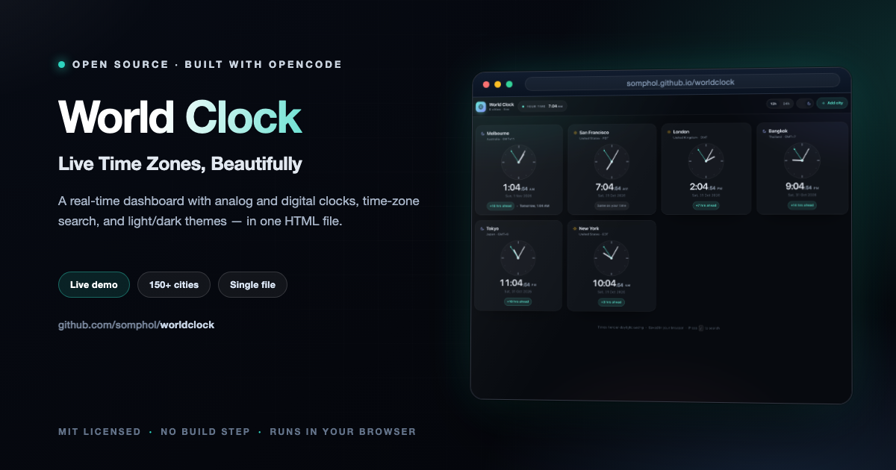

<div align="center">



# World Clock

**Live Time Zones, Beautifully**

A real-time dashboard with analog and digital clocks, time-zone search, and light/dark themes — in one HTML file.

[](https://somphol.github.io/worldclock/)
[](LICENSE)

**[Try it live →](https://somphol.github.io/worldclock/)**

</div>

---

## Features

- **Live city grid** — six default time zones (Melbourne, San Francisco, London, Bangkok, Tokyo, New York) with accurate times powered by `Intl.DateTimeFormat`.
- **Dual visuals** — every card shows a minimalist SVG analog clock with smoothly rotating hour, minute, and second hands alongside a clean digital readout.
- **Relative offset badges** — see at a glance how each city compares to your local time (for example `+3 hrs ahead`) plus a `Yesterday` / `Tomorrow` label when the calendar date differs.
- **Add any city** — search 150+ built-in cities or any IANA time zone and add it to your dashboard. Your list is saved in `localStorage`.
- **Light and dark themes** — a smooth animated toggle, with the initial theme taken from your system preference.
- **12h / 24h format** — switch formats instantly; the choice is also remembered.
- **Responsive and accessible** — fluid card grid, keyboard-friendly city search (`/` to open), reduced-motion support, and labelled controls.

## Run locally

Open `index.html` directly in a browser, or serve it with any static server:

```bash
python3 -m http.server 8000
# then visit http://localhost:8000
```

## Deploy

The app is a static site with no build step. Host it anywhere that serves static files: GitHub Pages, Netlify, Vercel, Cloudflare Pages, or a plain web server.

## How it works

- Time zones are resolved from the browser's IANA database through `Intl.DateTimeFormat`, so daylight-saving changes are handled automatically.
- UTC offsets are derived per time zone and re-checked periodically, keeping badges correct across DST transitions.
- The dashboard state (cities, theme, clock format) is stored locally in your browser. Nothing is sent to a server.

## Project structure

```
worldclock/
├── index.html   # the entire app: markup, styles, and scripts
├── preview.png  # dashboard screenshot used in this README
└── README.md
```

## Contributing

Contributions are welcome — bug reports, feature ideas, accessibility improvements, and
documentation fixes alike. Please read [CONTRIBUTING.md](CONTRIBUTING.md) and the
[Code of Conduct](CODE_OF_CONDUCT.md) before opening a pull request.

- **Found a bug?** [Open a bug report](https://github.com/somphol/worldclock/issues/new?template=bug_report.yml)
- **Have an idea?** [Request a feature](https://github.com/somphol/worldclock/issues/new?template=feature_request.yml)
- **Found a vulnerability?** Please follow [SECURITY.md](SECURITY.md) and report it privately.

## Documentation

| Document | Purpose |
| --- | --- |
| [README.md](README.md) | Overview, setup, controls, and architecture |
| [CHANGELOG.md](CHANGELOG.md) | Notable changes and release history |
| [CONTRIBUTING.md](CONTRIBUTING.md) | Local workflow, constraints, and pull request checks |
| [SECURITY.md](SECURITY.md) | Supported versions and private vulnerability reporting |
| [LICENSE](LICENSE) | MIT licence |

## License

Released under the [MIT License](LICENSE) © 2026 Somphol Boonjing.
